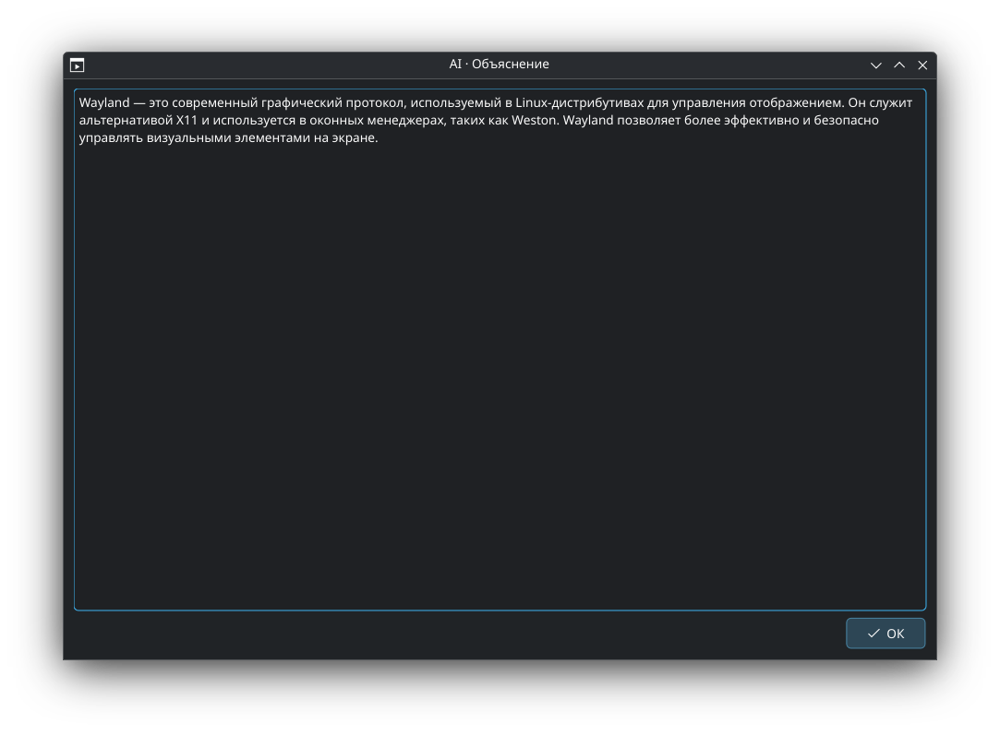

# ai-actions

**English** · [Русский](README.md)

**AI actions on a hotkey for KDE Plasma 6 (Wayland).**

Select text — press `Meta+Shift+T` — get a translation. Everything runs locally
via [Ollama](https://ollama.com), with no cloud and no subscriptions. The result
is copied to the clipboard automatically.




> **Windows:** an experimental `.exe` is available — [download ai-actions.exe](https://github.com/typer20045-cmd/ai-actions/releases/download/v1.2.0-windows/ai-actions.exe). Details: [WINDOWS.md](WINDOWS.md).

## What's new

**v1.1** — settings window, model downloads, translation target language,
memory controls and temporary screenshots.
[All releases](https://github.com/typer20045-cmd/ai-actions/releases).

## Features

- 🔤 **Translate** selected text into the chosen language (RU ⇄ EN by default)
- 🧠 **Explain** code, errors and terms in plain language
- 📝 **Summarize** in 3–5 bullets
- ✍️ **Fix** spelling and style
- 📷 **OCR**: select a screen region → recognize → explain
- 💬 **Ask the model** with context from the clipboard
- ⚙️ **Settings window**: model, downloads, shortcuts, language, memory
- 🌍 **Translation target** — 14 languages or auto RU ⇄ EN
- 🧹 **Temporary screenshots** — deleted right after OCR
- 🧠 **Memory control**: `keep_alive`, warm-up, VRAM status
- 📋 The answer is already in the clipboard — just `Ctrl+V`
- ⚡ ~0.8 s warm response on GPU, fully offline
- 🪶 No daemon, no Electron: Python + KDE `.desktop` files

## Hotkeys

| Keys | What it does |
|---|---|
| `Meta+Shift+T` | Translate the selection (RU ⇄ EN or the chosen language) |
| `Meta+Shift+E` | Explain the selection (code, error, term) |
| `Meta+Shift+M` | Summarize (3–5 bullets) |
| `Meta+Shift+F` | Fix spelling and style |
| `Meta+Shift+O` | Select a screen region → OCR → explain |
| `Meta+Shift+Q` | Ask the model (optionally with clipboard context) |
| `Meta+Shift+P` | Open settings |

## Installation

You need KDE Plasma 6, Python 3.9+ and Ollama with a model. On most
distributions Ollama is installed as a systemd service and starts automatically
at boot — you don't need to launch it manually. Just pull a model:

```bash
ollama pull qwen3:8b
```

Check that the service is running:

```bash
systemctl status ollama        # should be active (running)
curl http://127.0.0.1:11434/api/version
```

Then:

```bash
git clone https://github.com/typer20045-cmd/ai-actions.git ~/ai-actions
cd ~/ai-actions
./install.sh
```

The script creates the `~/.local/bin/ai-actions` symlink and
`~/.local/share/applications/ai-actions-*.desktop` entries with
`X-KDE-Shortcuts`, then rebuilds the KDE database with `kbuildsycoca6` —
**shortcuts work immediately, with no re-login and no autostart**.

Dependencies for OCR, the clipboard and the settings window (Debian/Ubuntu):

```bash
sudo apt install -y wl-clipboard tesseract-ocr tesseract-ocr-rus python3-pyqt6
```

`kdialog`, `spectacle` and `qdbus6` are usually already installed with KDE.

## Verify

```bash
ai-actions doctor            # checklist: model, OCR, clipboard, shortcuts
ai-actions settings          # settings window
ai-actions explain --text "Segmentation fault (core dumped)"
ai-actions translate --clipboard
ai-actions explain --screen  # screen region + OCR
```

`doctor` shows what is configured and what is missing.

## Troubleshooting

**`doctor` says Ollama is unavailable:**

```bash
systemctl status ollama
sudo systemctl enable --now ollama   # start and enable at boot
```

**The first response is slow (~5–10 s):** this is normal — the model is loaded
into VRAM on the first request. After that, while `keep_alive` is active,
responses take ~0.8 s. Warm the model up immediately:

```bash
ai-actions warmup
```

Or enable “Load the model at login” in the settings (`ai-actions settings`).
Note: warm-up takes ~5 GB of VRAM right away.

**The model is unloaded from VRAM:** Ollama manages memory itself. When VRAM is
scarce it moves some layers to RAM, and when RAM is scarce it unloads the model
entirely. You can choose “Never unload” in the settings, but that does not
remove the memory limit: a smaller model or closing GPU-heavy apps will help.

**OCR screenshots don't pile up:** the snapshot is deleted right after
recognition, and files older than an hour are cleaned automatically on the next
capture.

**A hotkey doesn't work:** check that the entries exist
(`ls ~/.local/share/applications/ai-actions-*.desktop`) and rebuild the KDE
database:

```bash
kbuildsycoca6 --noincremental
```

If the combination is taken by another app, reassign it in System Settings →
Keyboard → Shortcuts.

**The selected text isn't read:** install `wl-clipboard`, or copy the text with
`Ctrl+C` first — the tool will take it from the clipboard.

## How it works

1. The hotkey launches a `.desktop` entry with `ai-actions <action>`.
2. The script reads the primary selection via `wl-paste --primary` (or the
   clipboard if `wl-clipboard` is not installed).
3. The text goes to local Ollama (`/api/generate`) or any OpenAI-compatible
   gateway.
4. The answer is shown in `kdialog` and copied via `wl-copy`.

There is no background process: KDE handles hotkeys itself, and the script runs
only when you press a key. Nothing extra needs to start after a reboot.

## Settings

Everything is configured in one window:

```bash
ai-actions settings      # or Meta+Shift+P
```

The window is also available in the application menu as **“AI: настройки”**
(AI: Settings) and through KRunner by “AI” or “settings”.

- **Model** — installed and recommended models. If a model is missing locally,
  it is downloaded through Ollama with a progress bar. You can type any name,
  for example `qwen3:4b` or `gemma3:4b`.
- **Keys** — click a field and press a combination. Changes apply immediately:
  the `.desktop` files and `kglobalshortcutsrc` are updated.
- **Translation** — target language: auto (RU ⇄ EN), Russian, English, German
  and 11 more.
- **Memory** — how long to keep the model loaded (`5 minutes` … `never unload`),
  warm-up at login, “Load now” / “Unload” buttons and VRAM status.

If the model is unloaded often, pick a smaller one or close GPU-heavy apps:
Ollama cannot keep more in VRAM than fits.

You can also edit `~/.config/ai-actions/config.json` by hand:

```json
{
  "api": "ollama",
  "host": "http://127.0.0.1:11434",
  "model": "qwen3:8b",
  "think": false,
  "temperature": 0.2,
  "num_predict": 900,
  "num_ctx": 8192,
  "keep_alive": "10m",
  "timeout": 180,
  "max_input_chars": 6000,
  "ocr_lang": "rus+eng",
  "translate_target": "auto",
  "warmup_on_login": false,
  "openai": {
    "base_url": "http://127.0.0.1:3001/v1",
    "api_key": "",
    "model": "qwen3:8b"
  }
}
```

- `model` — any model from `ollama list` (for example, `qwen3:4b` is faster).
- `translate_target` — `auto`, `ru`, `en`, `de`, `fr`, `es`, `it`, `pt`,
  `pl`, `tr`, `zh`, `ja`, `ko`, `ar`, `uk`.
- `keep_alive` — `5m`, `10m`, `1h`, `-1` (never unload), `0` (right after the
  response).
- `warmup_on_login` — warm the model up at login.
- `api: "openai"` — switch to an OpenAI-compatible `/v1/chat/completions`
  endpoint (LM Studio, llama.cpp server, your own gateway).
- `think: true` — qwen3 “thinking”: slower, but sometimes more accurate.
- `ocr_lang` — tesseract languages, for example `rus+eng`.

## Custom shortcuts

The easiest way is `ai-actions settings` (or `Meta+Shift+P`). You can also use
System Settings → Keyboard → Shortcuts → “AI: …”.
To add a new action, duplicate a `.desktop` file and add an entry to `ACTIONS`
in `ai_actions.py`.

## Uninstall

```bash
~/ai-actions/install.sh --uninstall
```

The config and logs remain in `~/.config/ai-actions` and `~/.cache/ai-actions`.

## Requirements

- KDE Plasma 6 on Wayland (X11 is untested)
- Python 3.9+
- PyQt6 — only for the settings window (`python3-pyqt6`)
- Ollama with any instruct model (default `qwen3:8b`, ~5 GB VRAM)
- `wl-clipboard` — reading the selection and copying the answer
- `tesseract-ocr` + language packs — only for OCR
- `kdialog` — result window

## Privacy

Text never leaves the machine: requests go to `127.0.0.1`. There is no
telemetry. The only network call is to the local model API.

## License

MIT — see [LICENSE](LICENSE).
