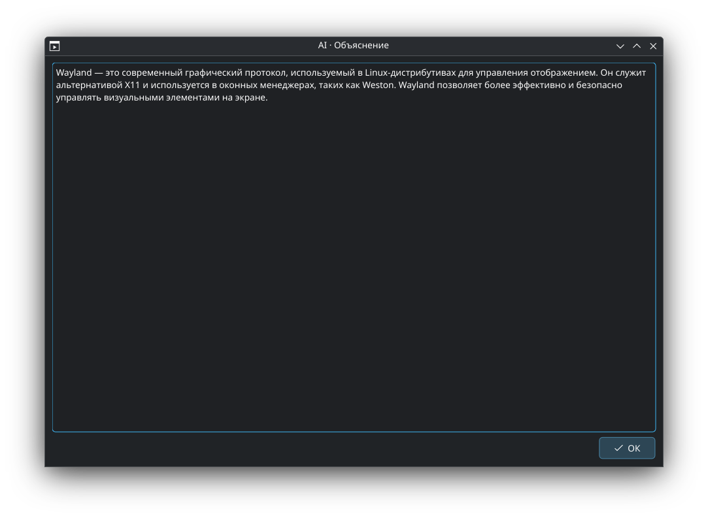

# ai-actions

**ИИ-действия по горячей клавише для KDE Plasma 6 (Wayland).**

Выдели текст — нажми `Meta+Shift+T` — получи перевод. Всё считается локально
через [Ollama](https://ollama.com), без облаков и подписок. Ответ сразу
копируется в буфер обмена.




## Возможности

- 🔤 **Перевод** выделенного текста RU ⇄ EN
- 🧠 **Объяснение** кода, ошибок и терминов простыми словами
- 📝 **Пересказ** в 3–5 пунктов
- ✍️ **Исправление** орфографии и стиля
- 📷 **OCR**: выдели область экрана → распознай → объясни
- 💬 **Вопрос модели** с контекстом из буфера обмена
- 📋 Ответ автоматически в буфере — просто `Ctrl+V`
- ⚡ Тёплый ответ ~0.8 с на GPU, без интернета
- 🪶 Без демона и Electron: Python stdlib + `.desktop`-файлы KDE

## Горячие клавиши

| Клавиши | Что делает |
|---|---|
| `Meta+Shift+T` | Перевести выделенное (RU ⇄ EN) |
| `Meta+Shift+E` | Объяснить выделенное (код, ошибка, термин) |
| `Meta+Shift+M` | Кратко пересказать (3–5 пунктов) |
| `Meta+Shift+F` | Исправить орфографию и стиль |
| `Meta+Shift+O` | Выделить область экрана → OCR → объяснить |
| `Meta+Shift+Q` | Спросить модель (можно с контекстом из буфера) |

## Установка

Нужны KDE Plasma 6, Python 3.9+ и Ollama с моделью. В большинстве дистрибутивов
Ollama ставится как systemd-сервис и стартует автоматически при загрузке —
вручную запускать ничего не нужно. Достаточно скачать модель:

```bash
ollama pull qwen3:8b
```

Проверить, что сервис работает:

```bash
systemctl status ollama        # должно быть active (running)
curl http://127.0.0.1:11434/api/version
```

Затем:

```bash
git clone https://github.com/typer20045-cmd/ai-actions.git ~/ai-actions
cd ~/ai-actions
./install.sh
```

Скрипт создаст симлинк `~/.local/bin/ai-actions`, ярлыки
`~/.local/share/applications/ai-actions-*.desktop` с `X-KDE-Shortcuts` и
обновит базу KDE через `kbuildsycoca6` — **шорткаты работают сразу, без
перелогина и без автозапуска**.

Зависимости для OCR и работы с буфером (Debian/Ubuntu):

```bash
sudo apt install -y wl-clipboard tesseract-ocr tesseract-ocr-rus
```

`kdialog`, `spectacle` и `qdbus6` обычно уже стоят в KDE.

## Проверка

```bash
ai-actions doctor            # чек-лист: модель, OCR, буфер, шорткаты
ai-actions explain --text "Segmentation fault (core dumped)"
ai-actions translate --clipboard
ai-actions explain --screen  # снимок области + OCR
```

`doctor` покажет, что настроено, а что нужно доустановить.

## Если что-то не работает

**`doctor` пишет, что Ollama недоступен:**

```bash
systemctl status ollama
sudo systemctl enable --now ollama   # запустить и включить автозагрузку
```

**Первый ответ долгий (~5–10 с):** это нормально — модель загружается в VRAM
при первом запросе. Дальше, пока действует `keep_alive`, ответы занимают
~0.8 с. Чтобы прогреть модель сразу после входа в систему, добавь в
`~/.config/autostart/` ярлык с командой:

```bash
curl -s http://127.0.0.1:11434/api/generate \
  -d '{"model":"qwen3:8b","prompt":"","keep_alive":"10m"}' >/dev/null
```

**Хоткей не срабатывает:** проверь, что ярлыки на месте
(`ls ~/.local/share/applications/ai-actions-*.desktop`) и обнови базу KDE:

```bash
kbuildsycoca6 --noincremental
```

Если комбинация занята другим приложением, переназначь её в System Settings →
Keyboard → Shortcuts.

**Не читается выделенный текст:** установи `wl-clipboard` или сначала скопируй
текст через `Ctrl+C` — инструмент возьмёт его из буфера.

## Как это работает

1. Хоткей запускает `.desktop`-ярлык с командой `ai-actions <действие>`.
2. Скрипт берёт выделение через `wl-paste --primary` (или буфер, если
   `wl-clipboard` не установлен).
3. Текст уходит в локальный Ollama (`/api/generate`) или любой
   OpenAI-совместимый шлюз.
4. Ответ показывается в `kdialog` и копируется через `wl-copy`.

Никакого фонового процесса: KDE сам обрабатывает горячие клавиши, скрипт
запускается только по нажатию. Поэтому после перезагрузки ничего
дополнительно запускать не нужно.

## Настройки

`~/.config/ai-actions/config.json` создаётся при первом запуске:

```json
{
  "api": "ollama",
  "host": "http://127.0.0.1:11434",
  "model": "qwen3:8b",
  "think": false,
  "temperature": 0.2,
  "num_predict": 900,
  "num_ctx": 8192,
  "keep_alive": "10m",
  "timeout": 180,
  "max_input_chars": 6000,
  "ocr_lang": "rus+eng",
  "openai": {
    "base_url": "http://127.0.0.1:3001/v1",
    "api_key": "",
    "model": "qwen3:8b"
  }
}
```

- `model` — любая модель из `ollama list` (например, `qwen3:4b` быстрее).
- `api: "openai"` — переключение на OpenAI-совместимый `/v1/chat/completions`
  (LM Studio, llama.cpp server, свой шлюз).
- `think: true` — «размышления» qwen3: медленнее, но иногда точнее.
- `keep_alive` — сколько держать модель в VRAM между вызовами.
- `ocr_lang` — языки tesseract, например `rus+eng`.

## Свои комбинации

System Settings → Keyboard → Shortcuts → найдите «AI: …» и переназначьте.
Новое действие добавляется дублированием `.desktop`-файла и записи в
`ACTIONS` внутри `ai_actions.py`.

## Удаление

```bash
~/ai-actions/install.sh --uninstall
```

Конфиг и логи остаются в `~/.config/ai-actions` и `~/.cache/ai-actions`.

## Требования

- KDE Plasma 6 на Wayland (X11 не тестировался)
- Python 3.9+
- Ollama с любой instruct-моделью (по умолчанию `qwen3:8b`, ~5 ГБ VRAM)
- `wl-clipboard` — чтение выделения и копирование ответа
- `tesseract-ocr` + языковые пакеты — только для OCR
- `kdialog` — окно с результатом

## Приватность

Текст не покидает машину: запросы идут на `127.0.0.1`. Телеметрии нет.
Единственный сетевой вызов — к локальному API модели.

## Лицензия

MIT — см. [LICENSE](LICENSE).
